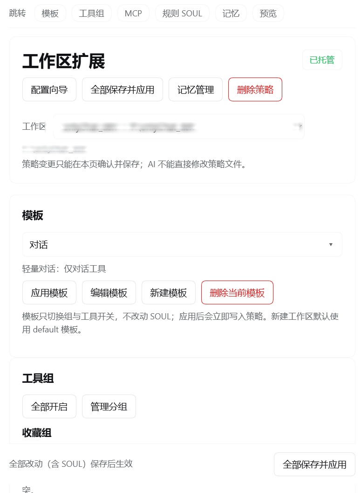
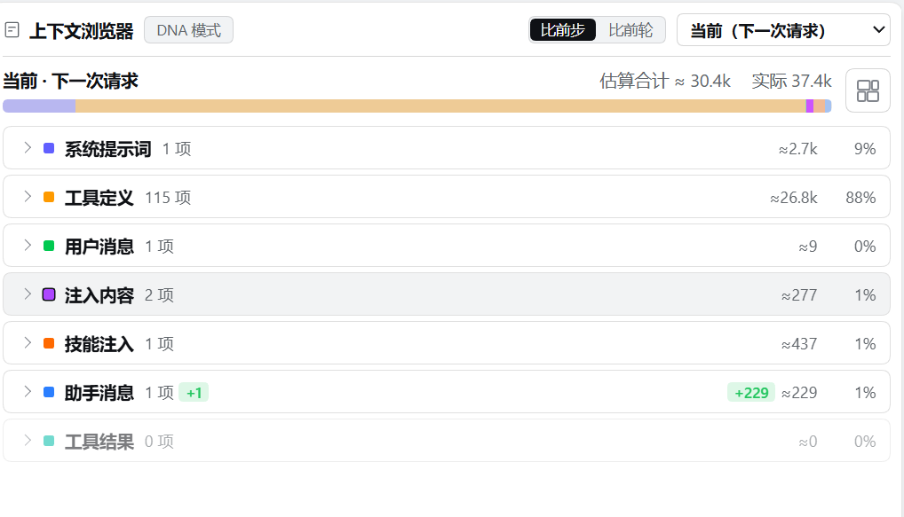
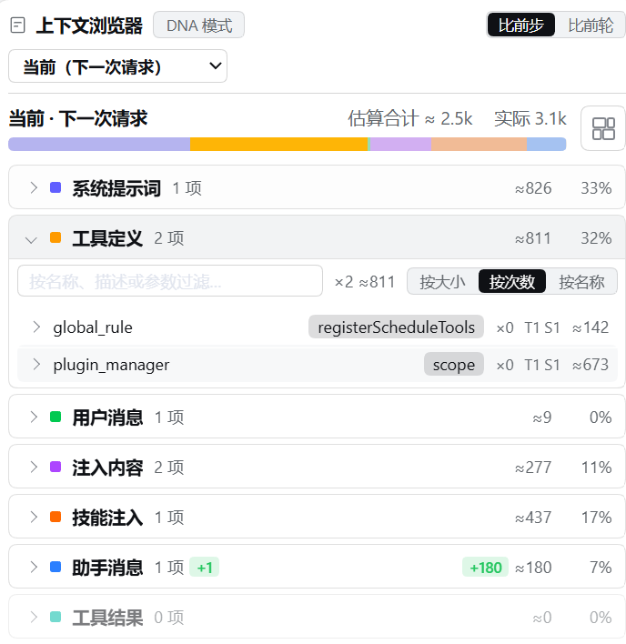
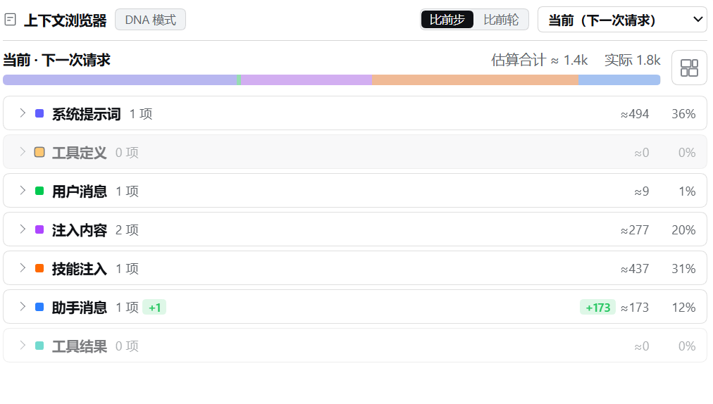
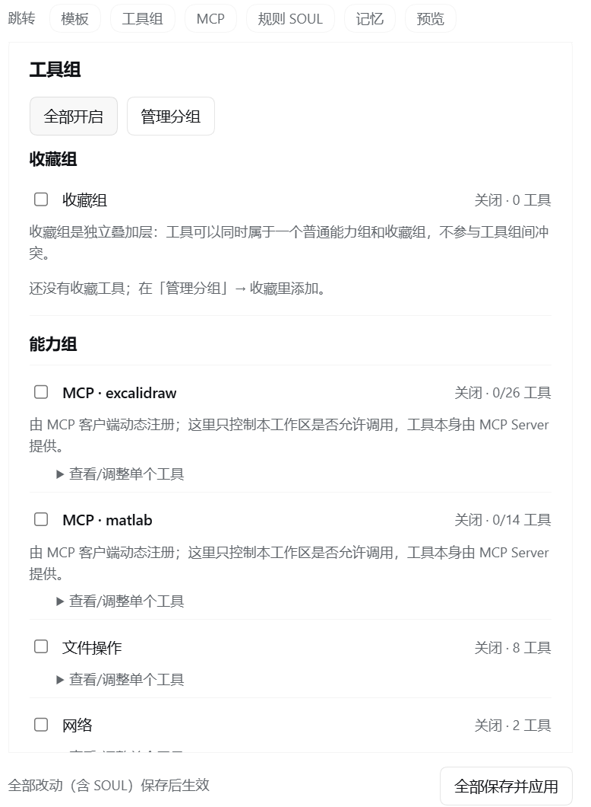
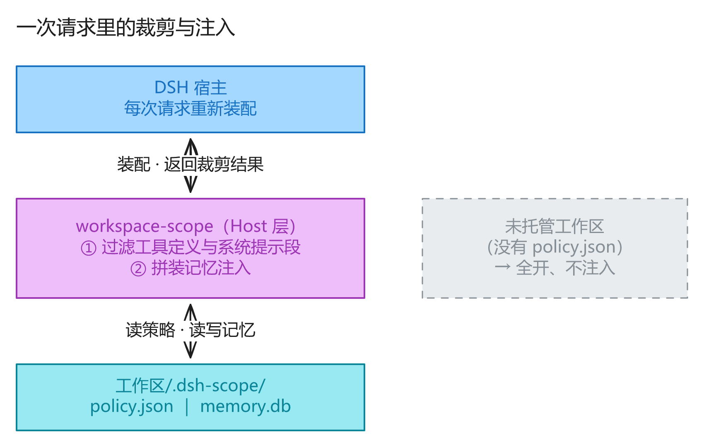

# dsh-workspace-scope（工作区扩展）

> 给 DeepSeek Harness 按**工作区**控制 AI 能看到什么、能用什么、能记住什么、拥有什么样的 SOUL，并附带一个**完全本地**的工作区内跨会话记忆库。

<p align="center">
  
</p>

**v0.4.0 · 源码安装** ｜ MIT ｜ Node ≥ 22.5

> 本项目为非官方社区插件，由社区开发者独立维护，与 DeepSeek 及其关联公司无隶属、合作或背书关系；DSH 及相关商标归其权利人所有，本项目仅在描述兼容性时使用这些名称。详见 [NOTICE](NOTICE)。

## 为什么需要它

DSH 默认把已注册的工具定义全部塞进每次请求。工具装得越多，模型能留给「真正干活」的上下文就越少——而且同一个 AI，在 A 项目该有全权限、在 B 项目可能只需要部分能力。

<table>
<tr>
<td align="center"></td>
<td align="center"></td>
<td align="center"></td>
</tr>
<tr>
<td align="center"><sub>全开：115 个工具定义，≈26.8k（88%）</sub></td>
<td align="center"><sub>部分开启：2 个工具定义，≈811（32%）</sub></td>
<td align="center"><sub>全部关闭：工具定义 0</sub></td>
</tr>
</table>

<sub>截图为 DSH 插件 dsh-context 的上下文浏览器，用于展示同一请求在三种状态下的构成差异。</sub>

## 特性

- **按工作区裁剪工具** —— 能力组、单工具 allow/deny、可叠加收藏组选择部分常用工具；没有策略文件的工作区完全 no-op，回到全开。
- **运行时工具发现** —— 第三方插件的工具按名字前缀自动成组（`runtime:<prefix>`），默认关闭，不在代码里硬编码别人的工具名。
- **本地记忆库** —— 每个工作区一个 SQLite，跨会话记住项目结构、决策与你的原话；主题门（judge）把跑题的记忆挡在自动注入之外。
- **可控的注入** —— 首轮快照、每 N 轮关键词命中、压缩后重注入、反思轮，以及空闲触发的 dream 整理。记忆可按指定主题选择性注入，亦可选择完全手动审批。
- **全局 RULE** —— `/rule` 管理**跨工作区**规则（本插件唯一跨工作区的部分），按工作区的 `rules.global` 开关生效。
- **本地优先** —— 无遥测、无自有服务器；数据都在你自己磁盘上（见「数据与隐私」）。

## 快速开始

前置：DeepSeek Harness Desktop 已安装、Node ≥ 22.5、`~/.dsh/profiles/desktop/` 可写。

```powershell
git clone https://github.com/sqeqceqacv/dsh-workspace-scope.git C:\path\dsh-workspace-scope
```

然后编辑 `~/.dsh/profiles/desktop/package.json`，在**保留已有内容**的前提下加两项：

```json
{
  "dependencies": {
    "@local/dsh-workspace-scope": "link:C:/path/dsh-workspace-scope/packages/workspace-scope"
  },
  "dsh": {
    "profile": {
      "bundles": ["@local/dsh-workspace-scope"]
    }
  }
}
```

最后在 profile 目录执行 `pnpm install`，**完全退出并重启 DSH**；设置里出现「工作区扩展」即安装成功。

<details>
<summary>更稳妥的步骤（含备份）</summary>

1. 备份 profile：`Copy-Item "$env:USERPROFILE\.dsh\profiles\desktop\package.json" "$env:USERPROFILE\.dsh\profiles\desktop\package.json.bak"`
2. 按上面的 JSON 片段修改 `package.json`（不要整段覆盖，保留其他依赖与 bundle）
3. `Set-Location "$env:USERPROFILE\.dsh\profiles\desktop"; pnpm install`
4. 完全退出并重启 DSH，打开设置确认出现「工作区扩展」

</details>

> v0.4.0 只提供源码安装，暂不发布 npm 包。

## 界面

<p align="center">
  
</p>

设置页分六块：顶部信息 → 模板 → 工具组（收藏组 + 能力组）→ 规则/SOUL → MCP → 预览，带锚点导航与吸底保存。每个工具可单独开关；组可整体开关，也可删除后让组内工具进入「未分组」、再按需恢复。

## 工作原理

<p align="center">
  
</p>

每次请求都要重新装配：插件在这一步按当前工作区的 `policy.json` 过滤工具定义与系统提示段，再从 `memory.db` 拼出该注入的记忆。**没有 `policy.json` 的工作区走 no-op 分支**——不读策略、不裁剪、不注入，行为和没装插件一致。

图源文件：[docs/diagrams/architecture.excalidraw](docs/diagrams/architecture.excalidraw)（可用 Excalidraw 打开修改后重新导出）。

## 数据与隐私

- **工作区策略**：`<workspace>/.dsh-scope/policy.json`，仅本工作区读取。
- **记忆库**：`<workspace>/.dsh-scope/memory.db`（SQLite + WAL，**未加密**，含个人记忆正文），默认不进入 git。
- **记忆工具**：读写本地 SQLite，不经过插件自有服务器。
- **主题 judge / dream**：启用后，相关记忆片段、工作区名称与整理请求会通过**你配置的模型 provider** 发送；是否出网取决于该 provider，插件本身不内置外部服务。
- **会话日志**：位于 `$DSH_HOME/sessions/`；dream 整理时会遍历本工作区对应的会话日志（用于恢复上次模型路由与整理上下文），不依赖用户询问；模型在对话中读取会话原文时，受系统提示中的会话访问与凭据约束。
- **HTTP API**：仅本地 Host API，依赖 DSH 的同源校验，不额外提供 token——请勿把 DSH 暴露到局域网。
- **遥测**：不内置遥测、不上报使用数据；随产物分发的第三方许可见 [THIRD_PARTY_NOTICES.md](THIRD_PARTY_NOTICES.md)。

## 和 DSH 自带设置的关系

DSH 自带的是**全局**开关；本插件把粒度下沉到**工作区**，并且策略文件由用户持有、AI 不能自己改（守卫会拦下对 `policy.json` 的写入，也会拦 `pwsh` 绕过）。换句话说：安装插件 ≠ 给某个工作区授权，授权只发生在设置页里由你点击保存的那一刻。

## 常见问题

<details>
<summary><b>数据存在哪？删了能恢复吗？</b></summary>

策略与记忆都在工作区自己的 `.dsh-scope/` 里；另有 `$DSH_HOME/workspace-scope/` 存放模板、收藏、以及无写权限时的策略回退。删文件即删数据，没有云端副本；删除策略时弹窗会问是否同时删记忆库。
</details>

<details>
<summary><b>记忆会串到别的工作区吗？</b></summary>

不会。每个工作区一个独立库；project 标记「全局」只表示**本工作区**跨项目通用，不跨工作区。跨工作区请用 `/rule`。
</details>

<details>
<summary><b>关掉记忆会删数据吗？</b></summary>

不会。关掉只是不注册工具、不注入、不建库；数据留在原处。
</details>

<details>
<summary><b>升级后我原来的工具组不见了？</b></summary>

旧版的静态第三方组不会自动迁移，对应的 `runtime:<prefix>` 组默认关闭，需要在「管理分组」里手动启用一次。
</details>

<details>
<summary><b>改了开关要新开会话吗？</b></summary>

不必。开关在每次 system-prompt 装配时重新计算，通常下一轮消息即生效；想要确定性，重启 DSH 最稳。
</details>

<details>
<summary><b>怎么卸载？</b></summary>

从 profile 的 `package.json` 删掉 `dependencies` 与 `dsh.profile.bundles` 里的条目，重启 DSH。磁盘数据在 `<workspace>/.dsh-scope/` 与 `$DSH_HOME/workspace-scope/`，确认不需要后自行删除。
</details>

## 术语

| 词 | 含义 |
|---|---|
| 托管工作区 | 存在 `.dsh-scope/policy.json` 且 `enabled !== false` 的工作区；只有托管工作区受策略约束 |
| 策略（policy） | 工作区的开关集合：能力组、单工具 allow/deny、提示段、SOUL、记忆开关 |
| 能力组 | 一组工具的开关单位（如「文件操作」「网络」）；一个工具最多属于一个能力组 |
| 收藏组 | 独立叠加层，不参与能力组互斥 |
| 主题门（judge） | 判断一条记忆是否属于当前工作区主题的模型调用；不匹配或不确定的进 quarantine |
| quarantine | 暂存区：主题 judge 判定不匹配或不确定的记忆先放这里，不进入自动注入 |
| dream | 空闲时自动整理记忆的流程；也会遍历会话日志恢复上次模型路由 |
| SOUL | 工作区级的身份描述，作为数据注入（不是系统指令） |
| `runtime:<prefix>` | 外部插件工具按名字前缀自动生成的组，默认关闭 |

## 兼容性与已知限制

- 依赖 DSH 内部 Host/Client API，DSH 升级后可能需要适配；
- 尚未提供「会话级选择本次启用哪些工具/插件/记忆」的 UI；
- 新工作区的记忆库仍是首次实际使用时懒创建；
- judge 默认走 agent 默认模型，不一定等于当前对话模型；Ollama 等 provider 的模型列表未逐一实测；
- 本地 HTTP API 无额外 token，只依赖同源校验，别把 DSH 暴露到局域网；
- 内嵌记忆 Host/Client 是编译产物，改动 `dsh-meow-scope` 源码后必须重新同步（见开发文档）；
- CI 覆盖策略、全局 RULE 与记忆单元测试，不覆盖真实 DSH 页面交互；
- v0.4.0 暂不提供 npm 包。

## 文档与开发

- [docs/development.md](docs/development.md) —— 仓库结构、构建链、内嵌记忆同步、测试
- [docs/ui-api.md](docs/ui-api.md) —— UI / Host HTTP API v1
- [CHANGELOG.md](CHANGELOG.md) —— 版本变更

## 许可与归属

`packages/dsh-meow-scope` 是 [Phant0Meow/dsh-meow-memory](https://github.com/Phant0Meow/dsh-meow-memory) 的工作区分支 fork，遵循其 MIT 许可证，详见 [packages/dsh-meow-scope/LICENSE](packages/dsh-meow-scope/LICENSE)。

本仓库采用 MIT License，详见 [LICENSE](LICENSE)；上游归属与 fork 增量说明见 [NOTICE](NOTICE)；随产物分发的第三方依赖与许可全文见 [THIRD_PARTY_NOTICES.md](THIRD_PARTY_NOTICES.md)。
